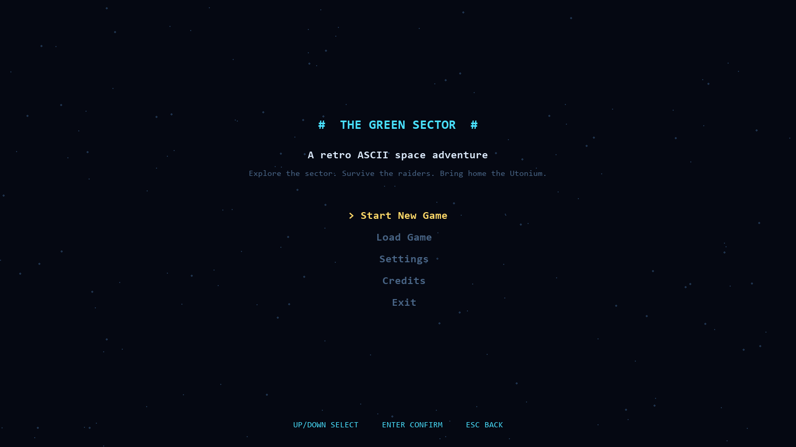
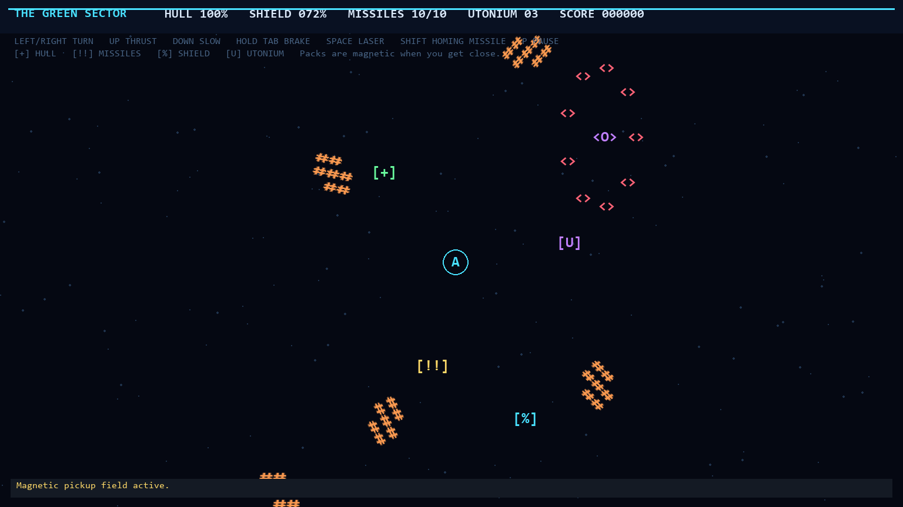

# The Green Sector: ASCII RPG

A full-screen, colorful ASCII space RPG built with Python and Pygame. The player ship is an aimable `A`; the sector contains drifting mother ships (`<O>`), escorting minion ships (`<>`), and tightly packed asteroid clusters (`#`) that rotate together as single rocks. Asteroids can be blasted apart and damage the ship on collision. Large asteroid impacts bounce the player backward. The game also features impact particles, screen shake, hull repair over time, and a low-hull visual and audio alarm.

## Screenshots





## Install and run on Windows

From the project root (`i-x20`):

```powershell
python -m pip install -e .
python -m ascii_rpg.main
```

Or, if you are already in `src\ascii_rpg`:

```powershell
python -m pip install pygame
python .\main.py
```

## Controls

- **Left / Right arrows**: rotate the ship
- **Up arrow**: accelerate in the direction the ship is pointing
- **Down arrow**: decelerate
- **Tab**: hold for gradual retro-thruster braking
- **Space**: fire unlimited straight-line lasers
- **Shift**: launch a missile (maximum carried: 10); 90% of launches home toward the nearest hostile ship
- **P** or **Esc**: pause; Esc resumes from the pause menu
- **F11**: toggle fullscreen

Lasers damage asteroids, raiders, and mother ships. Missiles home toward hostile ships, never acquire asteroids as targets, and can also damage anything in their flight path. Asteroid clusters rotate as single rocks, spawn with clearance from other clusters, and bounce apart on collision. Destroyed asteroids sometimes release uncommon Utonium mineral packs.

Collectible packs blink in distinct colors and are pulled toward the player within magnetic range: green `[+]` restores hull, yellow `[!!]` adds missiles, cyan `[%]` activates a 100% shield that drains by 1% per second, and purple `[U]` adds Utonium to cargo. A shield blocks laser and missile damage but does not prevent asteroid collision damage. Hull integrity regenerates at 1% per second after three seconds without taking damage. Below 20% hull, the screen border flashes and an alarm repeats. When hull reaches zero, the ship bursts into particles, then a GAME OVER screen appears before returning to the main menu.

Mother ships arrive with a close escort of five minion ships and return periodically after being destroyed. Their escorts hold formation around the mothership while engaging the player.

The main menu has **Start New Game**, **Load Game**, **Settings**, **Credits**, and **Exit**. The pause menu includes **Resume**, **Save Game**, **Load Game**, **Settings**, and **Exit to Main Menu**. Settings control fullscreen, impact particles, music, and sound effects.

Retro synth music and sound effects are generated by the game at runtime; no separate audio files are needed. Saves are stored in `savegame.json` in the project root.
